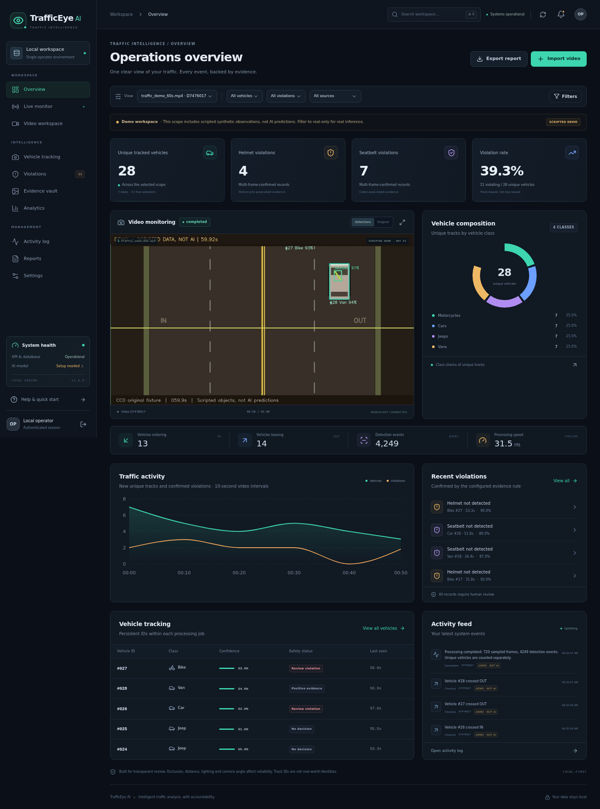

# TrafficEye AI
### Intelligent Traffic Violation Detection and Analytics System

A complete, **local-first, single-operator** video-analysis application: React/Vite/Tailwind/Recharts frontend, FastAPI API, OpenCV decoding, a configurable Ultralytics YOLO26 + PyTorch inference adapter, vehicle-only BoT-SORT tracking, conservative violation rules, SQLite persistence, authenticated evidence and streaming CSV reports.

> **Important boundary:** no custom-trained traffic weights or real labelled validation dataset were supplied. **Real helmet/seatbelt detection requires your trusted, appropriately trained checkpoint.** The included 60-second video is original synthetic artwork; its demo observations and scores are scripted, clearly labelled, and never represented as AI predictions. Generic COCO YOLO26 weights are intentionally rejected as incomplete safety models. This release is a tested local software system, **not a certified enforcement system or a claim of production ML accuracy**.



## What is functional

- Ten responsive views: Overview, Live processing monitor, Video workspace, Vehicle tracking, Violations, Evidence vault, Analytics, Activity log, Reports and Settings.
- MP4/AVI/MOV upload with streaming disk writes, extension/decoder/duration/dimension/size validation, local preview and H.264 browser preview conversion when needed.
- Default first 60 seconds or full-video processing, per-frame progress, elapsed active time, sampled-frame FPS, inference FPS, pause/resume, cooperative cancel and retry from frame zero.
- WebSocket latest-state updates with authenticated polling fallback; no UI-blocking inference or full-video memory load.
- Strict class-name validation, configurable model filename/device/resolution/confidence, automatic CPU selection when CUDA/MPS is unavailable.
- BoT-SORT on **vehicle boxes only**, per-job IDs and lost-track recovery; a clearly documented IoU/velocity tracker is used only in the synthetic demo.
- Spatial safety-object association, ambiguity rejection, confidence/size gates, multi-frame voting, zone filters, finite-line directional counting and duplicate suppression.
- Automatic JPEG evidence with video time, ID, type, scores and boxes; gallery/detail preview and authenticated image download.
- Persistent jobs, frame results, tracks, crossings, violation records and activity events in SQLite with WAL, bound SQL parameters and atomic frame checkpoints.
- Real aggregates, explicit percentage denominators, date/class/type/confidence/source filters and streamed spreadsheet-safe vehicle/violation CSV exports.
- Validated persistent settings; each job records an immutable configuration snapshot. Crash recovery marks unfinished jobs interrupted; retry recomputes them.
- Automated backend, frontend helper, production build and Chromium end-to-end checks, plus evaluation tools that require actual labels.

**Not included:** trained custom weights, a real annotated traffic dataset, RTSP/webcam ingestion, plate recognition, automatic fines, calibrated probabilities, multi-user roles, distributed workers, appearance ReID or a PDF-report feature. Unknown safety evidence is **not** a compliant verdict.

## 1. Prerequisites (Windows)

Install these before setup; no Docker or PostgreSQL is needed:

1. **64-bit Python 3.11–3.13** — Python 3.11/3.12 are good beginner choices. Enable **Add Python to PATH**. Official installer: <https://www.python.org/downloads/windows/>.
2. **Node.js 22 LTS** (or Node 20.19+/24 LTS) and npm: <https://nodejs.org/>. Reopen PowerShell after installation.
3. Several GB of free disk space for Python packages and footage. CPU mode works without an NVIDIA GPU. No GPU performance guarantee is made.
4. Internet is needed for initial pip/npm installs. The sample is bundled and can be regenerated locally; no third-party video download is required. Plotting during first model validation may fetch an Ultralytics font.

The delivered application was executed on **Linux/Python 3.13.16/CPU/Node 20.20.2**, not Windows hardware. The PowerShell scripts were parsed using real PowerShell and their argument-array helper was exercised; **Windows runtime installation still needs the steps below on your machine**. See [verification](docs/VERIFICATION.md) for exact evidence and limits.

## 2. Exact beginner PowerShell setup

Download and extract the ZIP. Keep the project in a normal writable folder, not under Program Files. From the directory containing the ZIP:

```powershell
Expand-Archive .\TrafficEye-AI.zip -DestinationPath .\TrafficEye-release
Set-Location .\TrafficEye-release\TrafficEye-AI
Set-ExecutionPolicy -Scope Process -ExecutionPolicy Bypass
.\scripts\Setup.ps1
```

`Setup.ps1` checks Python, creates `.venv`, installs a matching **CPU** PyTorch/torchvision pair, installs requirements, initializes SQLite and a random private access key, verifies/regenerates the sample, runs `npm ci`, and builds the frontend. It does not activate a shell-dependent environment or download model weights.

Start both services in separate PowerShell windows:

```powershell
.\scripts\Start-All.ps1
Get-Content .\data\access.key
```

Open **http://localhost:5173**, then paste that local access key into the unlock form. Never share or commit the key. If you set `TE_API_KEY` in `.env`, use that value instead; the file key is not used in that mode.

- Frontend: **http://localhost:5173**
- Backend health: **http://localhost:8000/api/health**
- Interactive API schema: **http://localhost:8000/api/docs**
- OpenAPI JSON: **http://localhost:8000/api/openapi.json**

Alternatively, run each service yourself:

```powershell
# Terminal 1, from the project root
.\scripts\Start-Backend.ps1

# Terminal 2, also from the project root
.\scripts\Start-Frontend.ps1
```

Stop with **Ctrl+C in each service window**. Do not start multiple Uvicorn workers or multiple backend processes against the same `data/` directory. The queue is intentionally single-process with one inference worker and a separate bounded preview worker.

### First successful workflow (no custom model required)

1. Unlock the dashboard.
2. **Video workspace → Import synthetic sample** (or upload `samples/traffic_demo_60s.mp4`).
3. Leave **Scripted demo · not AI** and **First 60 seconds** selected.
4. Click **Start processing**, then **Open monitor**. Try Pause/Resume or Cancel/Retry.
5. Open **Evidence vault** to review saved JPEGs. Open **Reports** to download CSVs.
6. Demo badges are retained in the dashboard, snapshots and report `source_mode` field. This exercise verifies software, **not ML accuracy**.

## 3. Real model setup

Required classes, in **any numeric order**:

| Vehicle labels | Safety labels |
|---|---|
| Bike, Car, Jeep, Van | Helmet, No-Helmet, Seatbelt, No-Seatbelt |

Exact normalized aliases are in `config/class_aliases.yaml`; labels are never guessed from numeric positions. Generic COCO labels, `person`, `bicycle`, `truck` etc. are not silently relabelled as custom safety classes.

Copy your **trusted, custom-trained YOLO26 axis-aligned detection checkpoint**:

```powershell
.\scripts\Configure-Model.ps1 -Weights (Read-Host 'Full path to your trusted best.pt')
```

The script copies it into `models/traffic-custom.pt`, saves the filename and checks class names. It refuses to silently overwrite existing weights. Or copy the file manually, set its local filename in **Settings → Model & inference**, **Save configuration**, then **Validate saved model**. Restart the backend if you used the command-line configuration tool while it was running.

A successful schema check says only that required labels exist. It does **not** establish model provenance, adequate training, correct annotation semantics or accuracy. **PyTorch checkpoints can execute code: load only trusted files.** Never bypass missing-class validation by renaming COCO classes.

For user footage, choose **Custom YOLO26 inference**. Arbitrary footage cannot use sample-scripted detections; its hash must match the bundled fixture to enable demo mode. See [model and dataset guidance](docs/MODEL_GUIDE.md).

### GPU option

Default setup is deliberately CPU-first. To use an NVIDIA GPU, install a **matching torch 2.9.1 + torchvision 0.24.1 CUDA wheel pair** into `.venv` using the official selector at <https://pytorch.org/get-started/locally/>, appropriate to your driver/GPU. When replacing previously installed CPU wheels, use the selector command with `--force-reinstall` and verify `torch.version.cuda` as well as availability. Then:

```powershell
.\scripts\Setup.ps1 -TorchMode Existing
.\.venv\Scripts\python.exe -c "import torch; print(torch.__version__, torch.cuda.is_available())"
```

Choose `auto` or `cuda:0` in Settings and save/validate. Device unavailability falls back to CPU; out-of-memory or incompatible kernels produce a failed job with an error, not fabricated results. CUDA execution was not tested on this CPU-only delivery environment.

## 4. Configuration

Copy `.env.example` to `.env` (setup does this without overwriting it). Environment settings control upload limits, data/model/sample paths, allowed origins, secure cookies and CPU thread count. Relative configured paths are anchored to the project root. Restart the backend after environment edits.

The dashboard stores future-job inference/tracking/voting/zone settings in `data/settings.json`. `config/defaults.json` documents defaults. The default confidence is 0.40, safety evidence 0.65, at least four supporting observations in a seven-observation window with a 0.67 ratio and 0.25-second evidence maturity across consecutive qualifying windows (reset on insufficient support). They are **uncalibrated starting values**.

- `frame_stride=1` means every frame. Increasing stride is explicit and can miss short events or destabilize tracking. It is not silently enabled for speed.
- Model inference uses letterbox resizing at the configured size. Original frame coordinates are retained in results/evidence.
- Sequential video inference is intentional for persistent tracking, frame-boundary controls and low latency. Evaluation exposes batch size; the application does not advertise unsupported video batching.
- Zones use normalized top-left coordinates. Bottom-center of a tracked vehicle selects the first matching polygon. Outside tracks remain visible but cannot create safety records/crossings.
- Counting uses a finite segment, a deadband and one IN/OUT event per `(job, track, direction)`. The default horizontal line is at 55% height, with downward crossing = IN.
- Retry deletes that job's previous observations/evidence and recomputes from frame zero. Cancellation retains partial processed results. Resume is only for an in-memory paused job, not restart-time checkpoint resumption.

## 5. Architecture and source layout

```text
TrafficEye-AI/
├── backend/
│   ├── app/
│   │   ├── main.py             ASGI lifecycle, request limits, CORS/security headers
│   │   ├── api.py              authenticated REST/media/WebSocket routes
│   │   ├── config.py           environment + validated per-job configuration
│   │   ├── schemas.py          API request validation
│   │   ├── inference.py        trusted model loading, name mapping, YOLO prediction
│   │   ├── tracking.py         vehicle-only BoT-SORT + explicit demo tracker
│   │   ├── association.py      spatial matching, votes, zones, directional logic
│   │   ├── processing.py       bounded worker, controls, checkpoints, JPEG evidence
│   │   ├── video.py            streaming decode metadata + H.264 preview conversion
│   │   ├── database.py         SQLite schema/repositories/atomic checkpoints
│   │   ├── analytics.py        real aggregates, scopes and denominators
│   │   ├── reporting.py        streaming, formula-safe CSV
│   │   ├── security.py         private access key, signed sessions, safe paths
│   │   ├── events.py           bounded latest-state notification versions
│   │   ├── logging_config.py   structured JSON application logs
│   │   └── demo.py             original synthetic scene + scripted demo detector
│   └── tests/                 unit, API integration, actual-network protocol tests
├── frontend/
│   ├── src/{components,pages}  full React views, charts, video, controls and dialogs
│   ├── src/{App,store,main}.jsx
│   ├── src/{api,utils}.js
│   ├── src/styles.css         responsive dark traffic-control theme
│   ├── tests/                 helper tests + real Chromium E2E workflow
│   ├── package.json           development/build/test commands
│   ├── package-lock.json      reproducible frontend dependency resolution
│   └── vite.config.js         relative /api proxy, including WebSockets
├── config/                    class aliases, BoT-SORT defaults, runtime defaults
├── models/                    model instructions; no trained weights bundled
├── samples/                   original CC0 60-second MP4 + hash/actor manifest
├── data/                      clean SQLite schema in release; private runtime data
├── evaluation/                detection, tracking and decision evaluators/exporter
├── scripts/                   Windows setup/start/test + cross-platform helpers
├── docs/                      architecture, API, safety, tests, actual screenshots
├── requirements{,-dev}.txt
├── .env.example
├── README.md
└── LICENSE                    AGPL-3.0; sample separately CC0
```

See [architecture and data flow](docs/ARCHITECTURE.md) for the component diagram, schema, rule semantics and concurrency model.

## 6. API and authentication

The UI uses relative `/api` URLs through Vite; browser code never calls another service at browser-local `localhost`. Backend launchers bind to loopback by default. For an explicitly exposed preview/LAN host, configure trusted hosts/origins and TLS deliberately.

Public endpoints: `/api/health`, `/api/auth/status`, `/api/auth/login`, API documentation/schema. All jobs, configuration, uploads, results, media, events and reports require a valid HttpOnly signed session or `Authorization: Bearer <your key>`. The WebSocket uses the session cookie and checks Origin. No filesystem folder is publicly mounted.

Example authenticated PowerShell calls:

```powershell
$Key = (Get-Content .\data\access.key -Raw).Trim()
$Headers = @{ Authorization = "Bearer $Key" }
Invoke-RestMethod http://localhost:8000/api/system -Headers $Headers
Invoke-WebRequest http://localhost:8000/api/reports.csv -Headers $Headers -OutFile .\violations.csv
```

Detailed endpoint table and requests: [API reference](docs/API.md). The signed local session lasts 12 hours; deleting a browser cookie logs out that browser, but an already stolen cookie can remain valid until expiry. Rotate the access key and restart to invalidate all signed sessions. No multi-user revocation or authorization roles are claimed.

## 7. Testing and evidence

From project root after setup:

```powershell
.\scripts\Test.ps1

# With both services running, include browser workflow verification:
.\scripts\Test.ps1 -Browser
```

Manual equivalents:

```powershell
.\.venv\Scripts\python.exe -m pytest -q --cov=backend/app --cov-report=term-missing
Set-Location frontend
npm test
npm run build
npx playwright install chromium
npm run test:e2e
```

Browser tests create their own sample job, check all 720 frames, progress, controls, tracker display, gallery/image/CSV downloads, navigation, errors, configuration, mobile widths and polling fallback, then remove only their own created jobs. They expect the default generated key at `data/access.key`; override `TE_E2E_KEY`/`TE_E2E_KEY_FILE` and `TE_E2E_URL` if needed. They generate synthetic-data screenshots in `docs/`. Do not run tests against private data if you do not want those screenshots to include it.

Some backend tests create a **randomly initialized, untrained eight-class YOLO26 network** from the installed architecture and an original labelled synthetic fixture to exercise actual CPU prediction, the real processing path and confusion-matrix/metrics serialization. These are **protocol tests**, not trained traffic-model evaluation or accuracy evidence. An optional test accepts `TE_TEST_COCO_WEIGHTS` to confirm generic weights are rejected.

The exact tested versions, results, actual evidence files, acceptance matrix and untested conditions are in **[docs/VERIFICATION.md](docs/VERIFICATION.md)**. Earlier discovered selector/accessibility and evaluation serialization issues were fixed before packaging.

### Verify or rebuild the delivered ZIP

The archive contains a clean initialized SQLite schema, **not** the development workspace's private data/key or pre-populated results. It includes source, lockfiles, tests, documentation, the synthetic sample, and the compiled `frontend/dist` build. Dependencies are installed by Setup; no custom weights are bundled.

After setup, you can verify the original ZIP (substitute its actual location):

```powershell
$ZipPath = Read-Host 'Full path to TrafficEye-AI.zip'
.\.venv\Scripts\python.exe scripts\verify_release.py $ZipPath
.\.venv\Scripts\python.exe scripts\smoke_release.py $ZipPath --rebuild-frontend
```

The first checks all manifest SHA-256 values, CRCs, required files, source syntax, clean database and demo checksum. The second extracts into a temporary directory, optionally installs/builds its frontend, then tests its actual backend upload → processing → evidence → CSV → application-restart persistence. It never uses your live data folder. This requires the installed Python requirements and is not a fresh Python-environment installation test.

Maintainers can rebuild a clean archive with `python scripts/package_release.py`. The adjacent `.zip.sha256` and JSON verification/smoke reports refer to the actual archive, avoiding a self-referential hash inside the ZIP. Hashes verify integrity, not publisher authenticity.

## 8. Evaluation and performance

For a **real, appropriately labelled** validation split and trusted model:

```powershell
.\.venv\Scripts\python.exe evaluation\evaluate_model.py --weights .\models\traffic-custom.pt --data .\your-data.yaml --device cpu --imgsz 640 --batch 4
```

This runs Ultralytics validation and writes genuine precision, recall, mAP@0.5, mAP@0.5:0.95, per-class results, a numeric confusion matrix and plotted matrix/curves. It reports measured per-image inference speed, not a made-up benchmark. Training/evaluation data must be split by camera/sequence to avoid leakage.

Separate tools export tracked boxes and compare labelled identities/violation adjudications. Formats, exact commands and limitations are in [evaluation guide](evaluation/README.md). There are **no real-world accuracy, tracking stability or association-accuracy benchmark claims** without the corresponding real ground truth.

## 9. Troubleshooting

| Symptom | Fix |
|---|---|
| Python/npm not found | Install supported 64-bit Python/Node, enable PATH and reopen PowerShell. `Setup.ps1 -PythonCommand <full-python-executable>` can select another interpreter. |
| Script execution disabled | `Set-ExecutionPolicy -Scope Process -ExecutionPolicy Bypass` changes only this shell. Or invoke `powershell -ExecutionPolicy Bypass -File .\scripts\Setup.ps1`. |
| Missing Python package / wrong interpreter | Use `.\.venv\Scripts\python.exe -m pip install -r requirements-dev.txt`; run `.\scripts\Doctor.ps1`. Do not use a different global Python to launch the API. |
| Torch/torchvision operator errors | Reinstall matching versions into `.venv` from the same CPU/CUDA index. Default `Setup.ps1` uses the CPU index. For CUDA use the official PyTorch selector and `-TorchMode Existing`. |
| No custom model / incomplete labels | Expected before configuration. Use labelled demo or install trusted eight-class weights and validate. Stock COCO is not a safety model. |
| Port 8000/5173 occupied | Stop the old process. Or `.\scripts\Start-All.ps1 -BackendPort 8010 -FrontendPort 5180`; same-origin proxy preserves Origin/Host. Always update both service/proxy ports. |
| API connection error | Verify `http://localhost:8000/api/health`; start backend from project root. Confirm Vite `TE_BACKEND_URL`, restart frontend after changes, and do not open `index.html` directly. |
| CORS/403 Origin error | Use Vite's same-origin `/api` proxy and the same localhost spelling. Add exact trusted origins to `TE_ALLOWED_ORIGINS` only for deliberate cross-origin usage. Do not use wildcard credentialed CORS. |
| WebSocket blocked | Proxy `/api` with `ws: true`, allow same Origin and authenticated cookies. The monitor automatically switches to polling; browser test covers this. |
| Login key rejected | Read `data/access.key` in the running workspace, or use configured `TE_API_KEY`. Default keys are randomly generated per installation. Expired sessions require unlocking again. |
| Blank UI after opening a file | Run the frontend server or production preview; do not double-click source HTML. The app has loading/error/empty states and a runtime error boundary. Check browser console and API health. |
| AVI/MOV does not play locally | Upload it. Backend produces an H.264 preview with installed `imageio-ffmpeg`; original footage is still used for analysis. Corrupt/unavailable codecs may need re-encoding. |
| Preview encoder missing | Reinstall `imageio-ffmpeg` for your platform or set `IMAGEIO_FFMPEG_EXE` to a trusted FFmpeg executable. No separate FFmpeg is needed with supported Windows wheels. |
| Video fails or time offsets drift | Re-encode variable-frame-rate or damaged footage to a constant-frame-rate MP4. This release uses frame index / reported FPS for video time; original capture time is unknown unless supplied. |
| Model slow on CPU | Use a smaller valid trained variant, appropriate resolution and a supported GPU. Frame skipping is explicit and can reduce reliability. Do not compare the throttled scripted demo FPS to model inference speed. |
| Locked database / interrupted jobs | Run one backend process only. Stop duplicate workers; retry interrupted jobs. Back up with backend stopped. Never delete SQLite sidecars while the service is active. |
| Disk usage grows | Delete old jobs in Video workspace. Each job stores original video, optional preview, frame JSON, latest image and confirmed evidence. No automatic evidentiary retention policy is invented. |

## 10. Security, privacy and deployment boundary

This release validates and size-limits uploads, verifies decode metadata, uses UUID-owned files, sanitizes names/CSV cells, validates configuration, parameterizes queries, authenticates private media, checks browser mutation/WebSocket origins and never serves an arbitrary user path. Logs do not include credentials/request bodies. Incomplete upload/checkpoint files are cleaned during startup.

It is **not** a hardened internet-facing multi-tenant service. Files are not encrypted at rest, local Windows ACLs/disk encryption remain your responsibility, signed sessions are not individually revocable, codec/ML libraries are native dependencies, and model checkpoints are trusted-code inputs. Use TLS, secure cookies, a restrictive reverse proxy, process sandboxing, regular patching, backups and formal security review before any network deployment. Vite development/preview is for local operation, not a public production server.

Helmet/seatbelt detections are particularly unreliable under occlusion, distance, poor light, glare, unsuitable viewpoints and multiple riders/passengers. Cabin-region association is a heuristic, **not verified driver identification**. Tracking can switch/fragment IDs and spatial deduplication can suppress nearby true events. **Human review and camera-specific ground-truth evaluation are mandatory.** No automatic penalties should be issued from this application.

## Licence and provenance

Project source: **GNU AGPL-3.0** (`LICENSE`). Original synthetic scene/video/manifest: **CC0-1.0** (`samples/LICENSE-CC0.txt`). Dependencies retain their own licences; Ultralytics offers AGPL/enterprise terms that must be reviewed for your deployment. No third-party road video, custom weights or private evidence are redistributed. See [third-party notices](docs/THIRD_PARTY.md).
