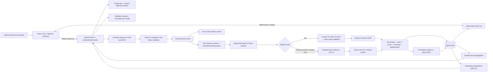

# Architecture and data flow

## Components

All browser requests use relative URLs. The browser never tries to access the sandbox/backend's loopback address directly. Vite proxies `/api` and WebSocket upgrade traffic to the configured backend.

## Frame processing

1. Request size is limited before/while ASGI receives the body; an additional streamed file-byte limit is applied. Multipart files spool to disk. A UUID storage name is unrelated to the untrusted original name.
2. OpenCV validates dimensions, FPS, reported duration/frame count and a decoded first frame. Unreadable/corrupt videos return meaningful errors. Supported source extensions are MP4, AVI and MOV; actual codec support depends on OpenCV's FFmpeg build.
3. An H.264 MP4 can serve as its own preview. Other sources are transcoded in a separate worker with bundled `imageio-ffmpeg`, no shell interpolation, no audio, a timeout and a maximum preview width. Analysis uses the original file, not the transcoded preview.
4. A job is uploaded → queued → running → completed/failed/cancelled. Running ↔ paused is cooperative at frame boundaries. Pending jobs can be cancelled. Restarted queued/running/paused jobs become interrupted; retry starts at frame zero.
5. Sequential decoding preserves temporal order. The configured stride explicitly skips inference on selected source frames. No video is loaded wholesale into RAM. Video offsets use frame index / reported FPS, so constant-frame-rate source footage is recommended.
6. For real mode, trusted local weights are loaded lazily under a model lock; canonical labels are mapped by actual model names, not class ID assumptions. All eight classes must be present. Only vehicle boxes are passed to a new per-job BoT-SORT instance. Auxiliary safety boxes are not counted as vehicles.
7. A safety object can associate to at most one eligible vehicle region. Intersection-over-object overlap must pass threshold; near-tied vehicles and near-tied contradictory safety labels are rejected. Bike regions expand upward to include a rider head; car/Jeep/Van use the upper cabin region. This is a heuristic, not person/driver identification.
8. Per-identity deques include unknown observations. A decision needs minimum supporting votes, vote ratio over all observations in the current window, minimum video-time maturity across consecutive qualifying windows, current supporting evidence, confidence and minimum vehicle size. Maturity resets when vote count/ratio loses support or an identity is absent for more than two seconds. It is not capped by the time covered by N frames, so normal/high-FPS footage can satisfy the duration gate. Missing a helmet/belt box never implies a negative safety class.
9. The vehicle bottom-center selects a named zone. Outside tracks remain persisted, but evidence decisions and crossings are disabled outside zones. A finite count line, hysteresis and per-direction identity set prevent repeat jitter counts.
10. One violation per `(job, track, type)` is allowed. A short high-IoU spatial cooldown can suppress duplicate fragments with a different ID. BoT-SORT recovers lost IDs where possible, but no global physical-identity guarantee exists.
11. Evidence is encoded and atomically replaced before the corresponding checkpoint transaction inserts the record. A checkpoint atomically inserts frame payload, upserts tracks, inserts violation/crossing rows, logs events and updates progress. An unreferenced image after a killed checkpoint is cleaned on startup.
12. The event hub holds version counters/latest-state notifications, not an unbounded stream of frame messages. Slow clients get the latest persistent state. WebSocket reconnect uses exponential backoff; HTTP polling remains authoritative when transport fails.

## Persistence

- `jobs`: source/preview metadata, lifecycle, selected mode, immutable configuration/options, counters and latest frame packet.
- `frames`: one JSON packet per sampled frame, including actual displayed detections, tracked boxes and measured inference time.
- `tracks`: primary key `(job_id, track_id)`, first/last video/reference time, peak vehicle confidence, observation count, last voted safety evidence and zone.
- `violations`: UUID, unique `(job_id, track_id, violation_type)`, timestamp basis/offset, mean supporting safety confidence, vote count, boxes and evidence filename.
- `crossings`: primary key `(job_id, track_id, direction)`.
- `events`: persistent state changes, errors, confirmations and crossings; no credentials.
- Foreign keys cascade on job deletion. WAL and short-lived, per-operation connections avoid sharing a SQLite connection across worker threads. Schema version is checked, not silently migrated across incompatible releases.

Runtime file paths are only derived from trusted base directories and owned database records. Evidence routes accept UUID record IDs, never arbitrary filesystem paths. Authentication is checked before media access. Media responses use `Cache-Control: no-store` and do not mount `data/` statically.

## Concurrency and restart behavior

One FastAPI/Uvicorn process and one inference worker are required. The pending queue is bounded by `TE_MAX_QUEUED_JOBS`; the active job is separate. A distinct preview worker performs codec conversion. A reentrant manager lock protects controls/queue admission and mutable transitions; model access has its own lock. CPU thread count is bounded. Existing jobs retain their own configuration even when future-job settings change.

Pause waits after the in-flight frame. Cancellation cannot interrupt an executing native decoder/model call immediately. Retry atomically clears old results from the database and removes owned evidence before submitting new work. Finished records survive restart. Startup removes unregistered upload/preview/frame/evidence files left by interrupted writes; do not manually store unrelated files inside runtime subfolders.

For multiple machines, high availability, shared queues, roles or public deployment, a distributed worker system, ownership-aware authorization, hardened ingress, metrics, retention controls and a different operational design are required. Those are deliberately not represented as implemented here.

## Metric semantics

`total_vehicles` = number of persisted unique `(job, track)` identities in the requested interval/class/source/peak-confidence scope. `motorcycles` counts Bike; `cars` counts only Car; `four_wheelers` counts Car+Jeep+Van. `detection_events` counts qualifying boxes across sampled frames, including safety classes unless class-filtered. A repeated box is not another unique vehicle.

`violation_rate = 100 × unique scoped vehicle identities with a matching confirmed record / all scoped unique identities`. Type filters change the numerator, not the denominator. This is **not** a legal noncompliance prevalence estimate because unobserved/unknown cases and tracker failures remain possible.

Track date scope uses presence-interval overlap; evidence/box/crossing timestamps use event reference time. Supplied recording start + offset is used when provided; otherwise import time + offset is a synthetic reference, not recovered capture metadata. A selected job uses 10-second video bins; multiple jobs use UTC minute bins.

Pipeline FPS = sampled frames / active elapsed seconds, excluding pauses but including decode/tracking/evidence/database/initialization. Inference FPS = sampled frames / cumulative model-call seconds, excluding pipeline overhead. Demo inference FPS is zero because no model ran. FPS uses the current/latest scoped job and is not class/date filtered. The demo has a deliberate small per-frame throttle for observable UI progress; never benchmark a real model with it.
